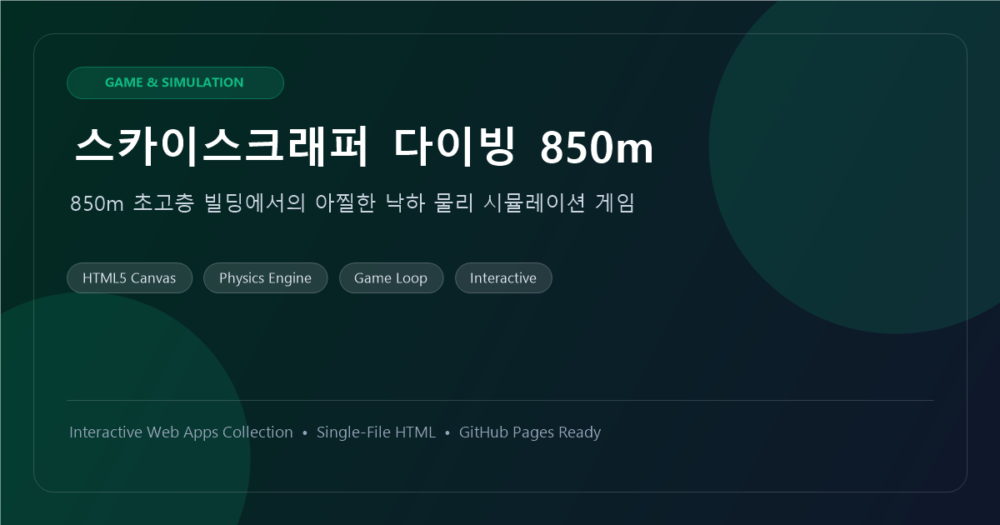
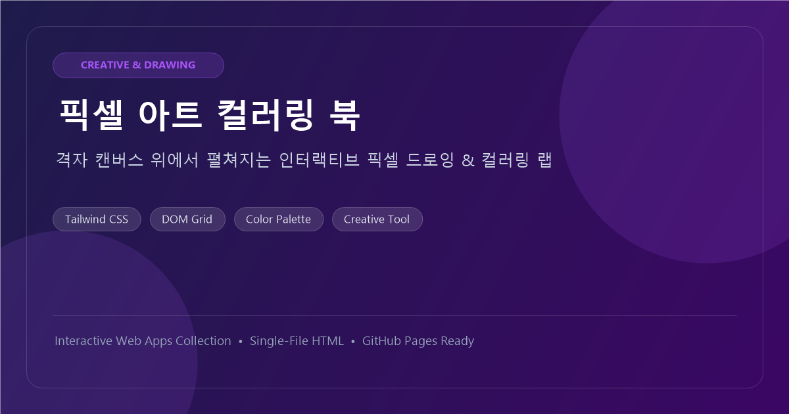
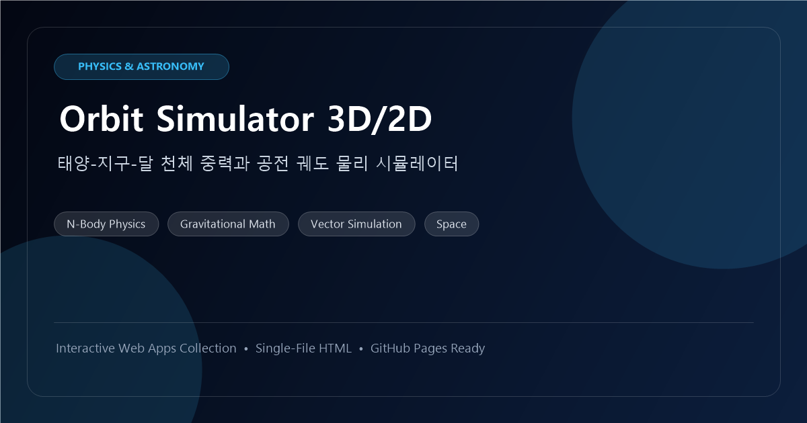
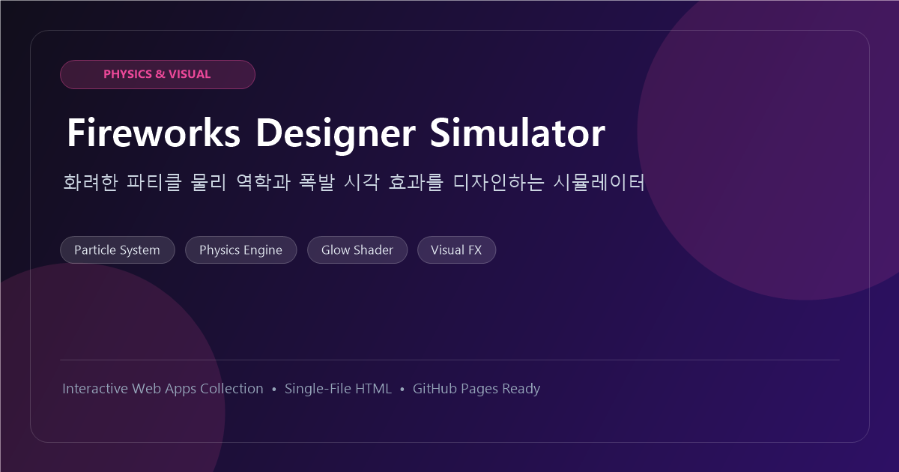
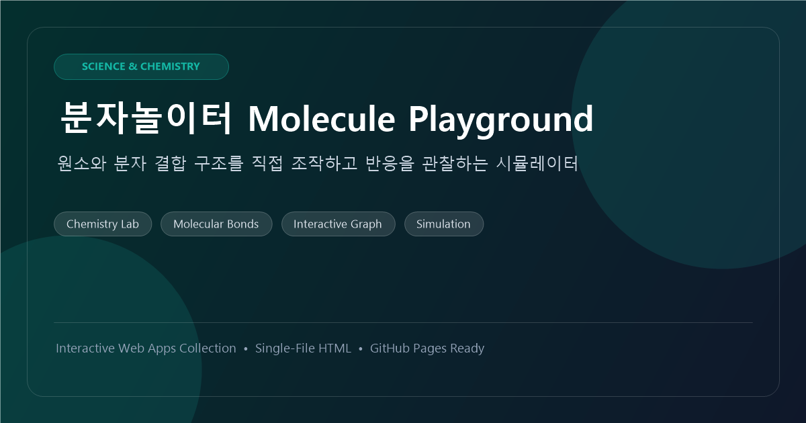
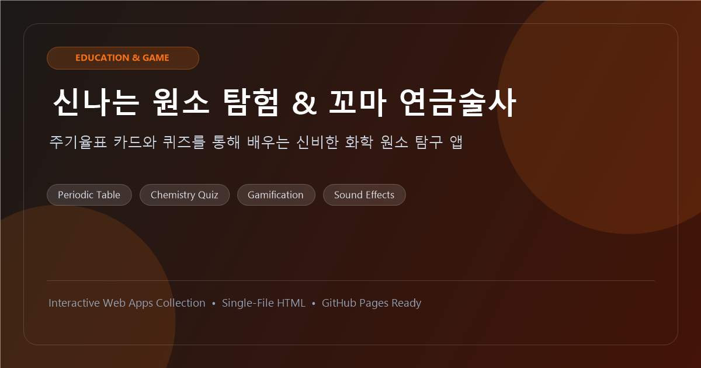
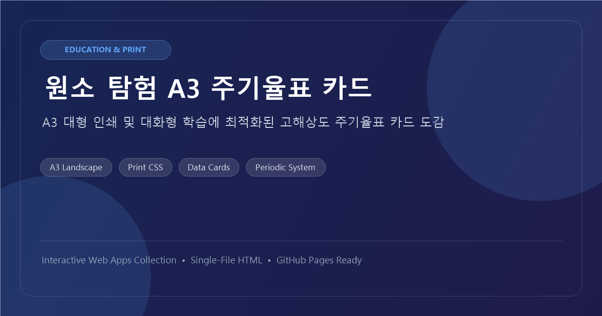

# 🚀 Interactive Web Apps Showcase

> **브라우저에서 즉시 실행되는 7종의 독립형(Single-File) 인터랙티브 웹 시뮬레이터 & 교육용 웹앱 컬렉션**

[](#-배포-및-github-pages-설정)
[](https://developer.mozilla.org/en-US/docs/Web/HTML)
[](https://developer.mozilla.org/en-US/docs/Web/JavaScript)
[](LICENSE)

---

## 🌟 프로젝트 소개

본 저장소는 별도의 백엔드 서버나 빌드 과정 없이, 브라우저만 있으면 언제 어디서나 바로 구동되는 **7종의 순수 클라이언트 사이드 인터랙티브 웹 애플리케이션 모음**입니다.

모든 앱은 HTML, CSS, JavaScript가 하나의 파일에 완결된 **자급자족형(Single-File)** 구조를 띠고 있으며, Open Graph(OG) 메타데이터, Favicon, 그리고 한눈에 모든 앱을 검색하고 실행할 수 있는 **메인 쇼케이스 포털(`index.html`)**이 완비되어 있습니다.

---

## 📱 앱 카탈로그 (Catalog)

### 1. 🎮 게임 & 크리에이티브 (Games & Creative)
| 앱 명칭 | 미리보기 | 주요 기술 & 특징 | 바로가기 |
| :--- | :---: | :--- | :---: |
| **스카이스크래퍼 다이빙 850m** |  | • HTML5 Canvas 2D<br>• 중력/낙하 가속도 물리 엔진<br>• 사운드 FX 및 실시간 게임 루프 | [실행](apps/games/skyscraper-diving.html) |
| **픽셀 아트 컬러링 북** |  | • Tailwind CSS 기반 격자 그리드<br>• 동적 색상 팔레트 및 채색 도구<br>• 직관적인 UI/UX | [실행](apps/games/pixel-art-coloring.html) |

### 2. 🔬 과학 & 물리 시뮬레이션 (Science & Simulation)
| 앱 명칭 | 미리보기 | 주요 기술 & 특징 | 바로가기 |
| :--- | :---: | :--- | :---: |
| **Orbit Simulator 3D/2D** |  | • N-Body 중력 물리 시뮬레이션<br>• 태양-지구-달 공전 궤도 벡터 계산<br>• 시간 배속 및 궤적 시각화 | [실행](apps/science/orbit-simulator.html) |
| **Fireworks Designer Simulator** |  | • 파티클 역학 시뮬레이터<br>• Glow 쉐이더 및 폭발 연출 랩<br>• 파라미터 실시간 조정 UI | [실행](apps/science/fireworks-designer.html) |
| **분자놀이터 (Molecule Playground)** |  | • 화학 분자 결합 구조 시뮬레이션<br>• 인터랙티브 노드 그래프 드래그<br>• 결합 안정성 시각 피드백 | [실행](apps/science/molecule-playground.html) |

### 3. 📚 교육 & 인터랙티브 (Education & Interactive)
| 앱 명칭 | 미리보기 | 주요 기술 & 특징 | 바로가기 |
| :--- | :---: | :--- | :---: |
| **신나는 원소 탐험 & 꼬마 연금술사** |  | • 주기율표 퀴즈 & 게임화 학습<br>• 오디오 효과음 및 탐구 도감<br>• 유아/초등 대상 과학 교육 | [실행](apps/education/element-explorer.html) |
| **원소 탐험 A3 주기율표 카드** |  | • A3 가로 인쇄 최적화 Print CSS<br>• 고해상도 주기율표 카드 뷰어<br>• 대형 출력 및 학습 교구용 | [실행](apps/education/periodic-table-cards.html) |

---

## 📂 디렉토리 구조 (Repository Layout)

```text
interactive-web-apps/
├── index.html                   # 메인 쇼케이스 랜딩 포털 (카탈로그 & 검색 & 필터)
├── README.md                    # 프로젝트 문서
├── .gitignore                   # Git 제외 설정
├── assets/
│   ├── favicons/                # 각 앱별 SVG 및 PNG 파비콘 (16종)
│   │   ├── favicon.svg          # 쇼케이스 메인 파비콘
│   │   └── favicon-*.png/.svg   # 개별 앱 파비콘
│   └── og/                      # 고해상도 Open Graph (1200x630) 이미지 (8종)
│       ├── og-main.png          # 쇼케이스 메인 SNS 공유 카드
│       └── og-*.png             # 개별 앱 SNS 공유 카드
└── apps/
    ├── games/                   # 게임 및 아트 앱
    │   ├── skyscraper-diving.html
    │   └── pixel-art-coloring.html
    ├── science/                 # 물리 및 화학 시뮬레이션
    │   ├── orbit-simulator.html
    │   ├── fireworks-designer.html
    │   └── molecule-playground.html
    └── education/               # 주기율표 및 학습 앱
        ├── element-explorer.html
        └── periodic-table-cards.html
```

---

## 💻 로컬에서 실행하기 (Quick Start)

별도의 `npm install`이나 로컬 서버 설정이 필요 없습니다.

1. 저장소를 클론하거나 다운로드합니다:
   ```bash
   git clone https://github.com/<your-username>/interactive-web-apps.git
   cd interactive-web-apps
   ```
2. 최상위의 **`index.html`** 파일을 더블 클릭하여 웹 브라우저(Chrome, Edge, Safari 등)에서 엽니다.
3. 원하는 앱의 **🚀 실행하기** 버튼을 클릭하여 즉시 체험할 수 있습니다. 각 앱 상단의 **← Showcase** 버튼을 누르면 언제든지 메인 포털로 돌아옵니다.

---

## 🌐 GitHub Pages 배포 방법 (Deployment)

GitHub Pages를 켜면 단 1분 만에 웹 호스팅이 완료됩니다:

1. GitHub에서 새로운 공개(Public) 저장소를 생성합니다.
2. 로컬 저장소를 GitHub에 푸시합니다:
   ```bash
   git remote add origin https://github.com/<your-username>/interactive-web-apps.git
   git branch -M main
   git push -u origin main
   ```
3. GitHub 저장소의 **Settings** → 좌측 **Pages** 메뉴로 이동합니다.
4. **Build and deployment** 항목에서:
   - **Source**: `Deploy from a branch`
   - **Branch**: `main` / `/ (root)` 선택 후 **Save** 클릭
5. 1~2분 후 생성되는 `https://<your-username>.github.io/interactive-web-apps/` 주소로 접속하면 전 세계 어디서든 라이브 데모를 이용할 수 있습니다!

---

## 📄 라이선스 (License)

본 프로젝트는 [MIT License](LICENSE)에 따라 자유롭게 수정 및 배포가 가능합니다.